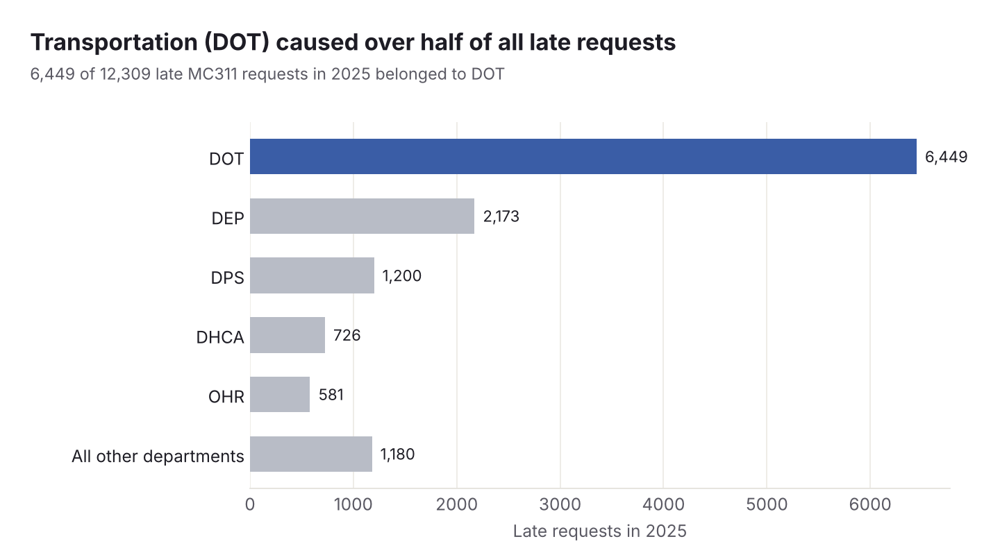
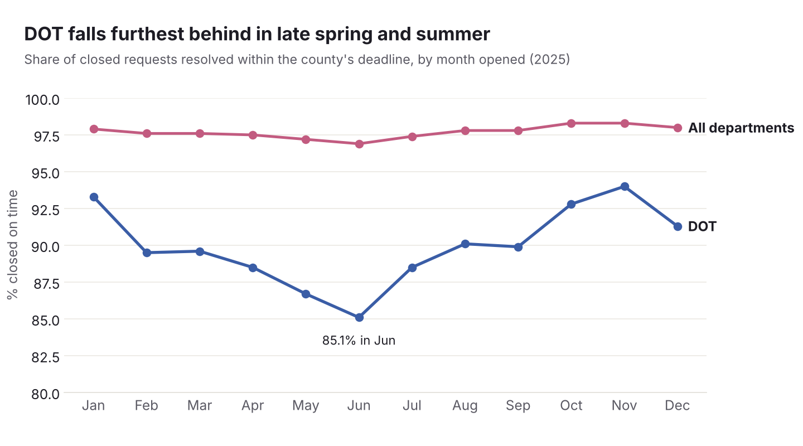
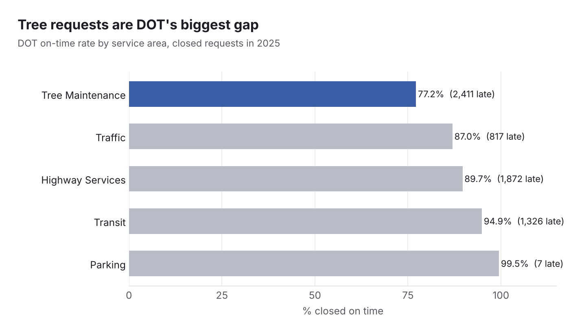
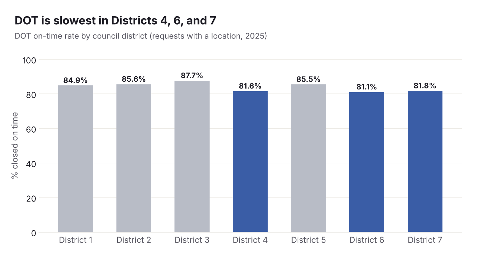

# Is Montgomery County Keeping Its Promises?

A SQL analysis of **531,108 MC311 service requests** from 2025: the calls, web forms, and emails Montgomery County, MD residents send about things like trash pickup, potholes, fallen trees, and bus service.

Every request comes with a promise: a deadline, in business days, for the responsible department to resolve it. I used SQL to find out how often the county keeps that promise, which departments miss it, and when and where they fall behind.



## Key findings

**1. The county is on time 97.7% of the time, but one department drives most of the misses.**
Of 527,016 closed requests with a deadline, 12,309 were late. The Department of Transportation (DOT) was on time only **89.8%** of the time and accounted for **6,449 late requests, over half of all late requests in the county**. DOT sits 8.2 points below the average department.

**2. Tree requests are DOT's biggest problem.**
Tree Maintenance was on time only **77.2%** of the time (2,411 late). The single most-missed request type is "Inspect, Remove or Prune County Tree," at 66% on time, so a third of these requests miss their deadline. Ride On bus complaints and pothole repairs come next.

**3. DOT falls behind every spring and summer.**
DOT's on-time rate drops from 93.3% in January to **85.1% in June**, then recovers in the fall. Request volume across the county also peaks in June and July (about 54,000 in July). This lines up with storm season, when trees come down and roads take damage.



**4. Where you live matters for DOT requests.**
Across all departments, council districts are close (95.2% to 96.7% on time). For DOT, Districts **6, 4, and 7** are around **81 to 82%** on time, compared with 87.7% in District 3.





## What I would recommend

- **Plan tree crews around the season.** Add tree inspection and removal capacity from April through July, before the backlog builds.
- **Look at tree request deadlines.** Missing a third of tree deadlines suggests the deadline may not match how long the work really takes. Either the staffing or the promise should change.
- **Start with Districts 4, 6, and 7** when testing any DOT fix, since that's where residents wait longest.

## Data quality checks

Before analyzing anything, I checked what was in the data:

- **No duplicates:** 531,108 rows and 531,108 unique request IDs.
- **Open requests line up:** 3,901 requests have no closed date, and exactly 3,901 are still "In Progress."
- **Inconsistent city names:** "SILVER SPRING" and "Silver Spring" counted as different cities. Standardizing them cut 584 city spellings down to 456.
- **Half the requests have no location:** 53% have no zip code or council district. Before comparing districts, I checked whether those rows were different, and they were. Requests without a location were 99.0% on time vs. 96.1% for those with one, because most are health and human services questions or calls passed to other agencies, not work someone has to go do at an address. So I compared districts using only requests with a location.
- **The on-time flag is reliable:** for every closed request, the county's on-time flag matched "days open is at most the deadline."

## How I did it

| File | What it does |
|---|---|
| `01_setup.sql` | Creates the `mc311` database |
| `02_load.sql` | Loads the 2025 CSV into a raw table with `LOAD DATA` (531,108 rows in about 12 seconds) |
| `03_explore.sql` | Checks duplicates, date range, status, departments, contact methods, and missing values |
| `04_clean.sql` | Builds a clean `requests` table: real dates, numbers, `NULL` for blanks, standardized city names, and a primary key |
| `05_departments.sql` | Top requests, overall on-time rate, and on-time rate by department |
| `06_dot_deep_dive.sql` | DOT by service area, request type, and month |
| `07_by_district.sql` | Tests whether missing locations are different, then compares council districts |
| `08_advanced.sql` | CTEs and window functions: month-over-month change with `LAG`, top 3 requests per department with `RANK`, and each department vs. the average with `AVG() OVER ()` |
| `09_dashboard_view.sql` | A view of the clean, closed requests for dashboards |
| `results/` | Query results used for the charts |
| `make_charts.py` | Builds the charts in `charts/` from those results (Python, pandas, matplotlib) |

**SQL skills used:** `GROUP BY` and `HAVING`, `CASE WHEN`, `NULLIF`, date functions, type conversion, views, CTEs, and window functions (`LAG`, `RANK`, `AVG() OVER ()`).

## Run it yourself

1. Download the 2025 data from Montgomery County's open data portal (MC311 Service Requests):
   ```
   https://data.montgomerycountymd.gov/resource/xtyh-brr2.csv?$select=sr_num,created,closed,sr_stat_id,department,sr_area,sr_sub_area,faq_ques_text,x_sla,x_city,x_zipcode,sr_subtype_cd,x_councildist,number_of_days_open,within_sla_window,sr_type&$where=created between '2025-01-01T00:00:00' and '2025-12-31T23:59:59'&$limit=600000
   ```
2. In MySQL 8.0, turn on local file loading (`SET GLOBAL local_infile = 1;`).
3. Update the file path in `02_load.sql`, then run the scripts in order.

The raw CSV (about 117 MB) isn't included because it's over GitHub's file size limit.

## Limitations

- **One year of data (2025).** Seasonal patterns should be confirmed with more years.
- **Deadlines are set by the county.** "On time" means on time against the county's own promise, which varies by request type (from 1 business day to several months).
- **Location is missing for 53% of requests,** so district comparisons only cover requests with an address.

**Data:** [Montgomery County, MD open data: MC311 Service Requests](https://data.montgomerycountymd.gov/)
**Tools:** MySQL 8.0, MySQL Workbench, Python (pandas, matplotlib)

*Heaven Brhanu, Information Science, University of Maryland*
